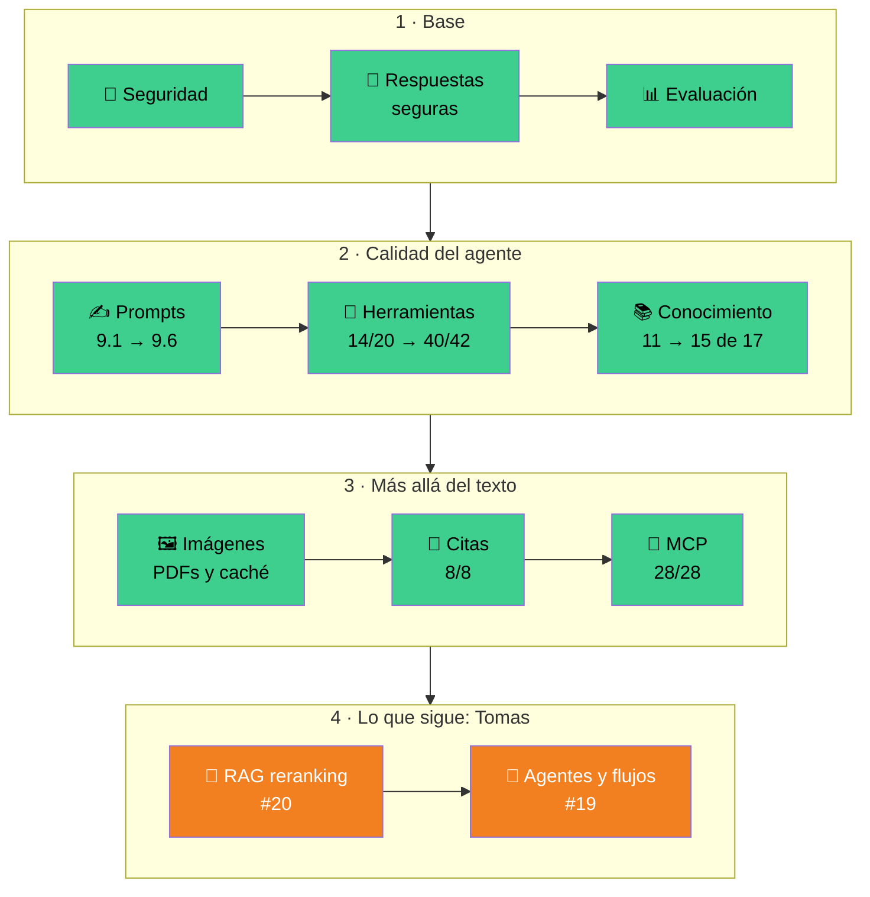
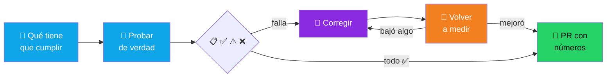
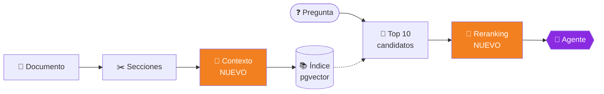
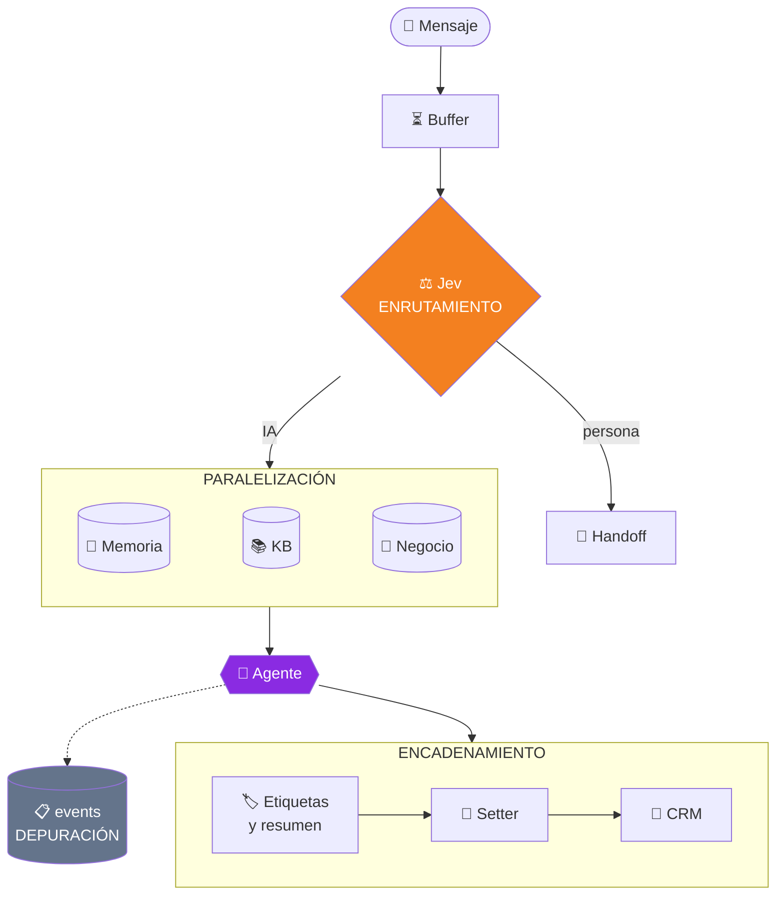

# 👋 Tomas: puesta al día de ARM WhatsApp

Este archivo te cuenta **todo lo que hicimos hasta ahora**, **cómo lo hicimos** y
**qué te toca a vos**, paso por paso. Leelo entero una vez antes de arrancar.
Después, el día a día está en [`COLABORAR.md`](COLABORAR.md).

> Al 03/11/2026 · `main` en `faec1f3` · producción en https://arm-whatsapp.vercel.app

---

## 1. Qué es ARM WhatsApp, en 30 segundos

Un inbox de WhatsApp multi-cliente donde un **agente de IA atiende junto al
equipo**: recuerda lo que dijo cada cliente (con la cita que lo respalda), usa
herramientas (agenda, stock, CRM), **propone las acciones sensibles y espera que
una persona las apruebe**, y sale a reactivar clientes con campañas con opt-in.

- Stack: Next.js 16 + React 19 + TypeScript · Supabase (RLS + pgvector) · Vercel · YCloud.
- IA: **FreeLLMAPI** (modelos gratis, compatible con OpenAI) a través de AI SDK v6.
- Cada **workspace** es un cliente. Gastón es el super admin ("Agency").

El README tiene los diagramas de cómo viaja un mensaje: [`README.md` → Las piezas de IA](README.md#-las-piezas-de-ia).

---

## 2. Lo que se hizo hasta ahora

La app se fue auditando **área por área**: primero se
prueba de verdad con modelos reales, se mide, se corrige lo que falla y se
vuelve a medir. Nada se mergea sin números.

| # | Área | PR | Qué se encontró | Qué quedó |
| --- | --- | --- | --- | --- |
| 0 | 🔐 Seguridad base | migraciones `20260618*` | Dos funciones de la cola se podían llamar con la clave pública: cualquiera leía mensajes de cualquier cliente. | Cerradas: solo las usa el servidor. |
| 1 | 💬 Respuestas de la IA | #6 | Los modelos gratis a veces cortan la respuesta, la mandan vacía o mezclan su razonamiento. | **Guardia** (`reply-guard.ts`) + cadena de modelos de respaldo + temperatura 0.3. |
| 2 | 📊 Evaluación | #10 | No había forma de medir. Al medir apareció que una nota en la memoria del cliente hacía que el agente ofreciera descuentos inexistentes. | `npm run eval:agente`: charlas de WhatsApp con nota por código y por un juez. |
| 3 | ✍️ Prompts | #12 | Los prompts de arranque eran genéricos. | Prompts v3 con reglas + su porqué, etiquetas XML y ejemplos difíciles. **9.1 → 9.6**. |
| 4 | 🔧 Herramientas | #13 | Ofrecía turnos sin mirar la agenda, tapaba errores, a veces no respondía después de usar una herramienta. | **14/20 → 40/42** (`npm run eval:herramientas`). |
| 5 | 📚 Base de conocimiento | #14 | Cortes que partían precios, búsqueda de respaldo con SQL armado a mano. | Corte por secciones, embeddings fijos. Fragmento correcto **primero en 15 de 17** (antes 11). Búsqueda híbrida: probada, **no aportó**, no se agregó. |
| 6 | 🖼️ Imágenes, PDFs y caché | #15 | El agente decía "no puedo leer el PDF". | PDFs leídos en el servidor, imágenes con modelo fijo, prompt ordenado para caché (**1% → 72%** reutilizable). |
| 7 | 📌 Citas | #16 | Las respuestas con datos de la KB no dejaban rastro. | El agente marca el fragmento, la marca se saca antes de llegar al cliente y el inbox muestra "Fuentes". **8/8**. |
| 8 | 🔌 MCP | #21, #22, #23 | El agente decía "no tenemos" sin consultar sus herramientas. Si la propuesta no se guardaba, igual prometía una confirmación. | Servidor MCP de administración en `mcp/admin/` y cliente MCP por workspace (Configuración → Sistemas). **28/28** los dos. Probado en vivo. |

**Líneas base que no pueden bajar** (son las que vas a defender en tus PRs):

| Evaluación | Número actual |
| --- | --- |
| `npm run eval:agente -- --versiones=v3 --reps=2` | **9.6** (10/10 en los chequeos por código) |
| `npm run eval:herramientas -- --reps=2` | **40/42** |
| `npm run eval:conocimiento` | fragmento correcto **primero en 15 de 17** |
| `npm run eval:multimedia` | **32/32** (audio, imágenes y PDFs) |
| `npm run eval:mcp -- --reps=2` | **28/28** |
| `npm run test:unit` | **30/30** (no necesita modelos) |

---

## 3. El método (el mismo para todas las áreas)

Tres reglas que aprendimos a los golpes:

1. **Si una técnica no mejora los números, no se agrega.** Se deja escrito que se
   probó y por qué no se usó (pasó con la búsqueda híbrida).
2. **Los modelos gratis varían de una corrida a otra:** medí siempre con
   `--reps=2` y compará contra la línea base, no contra una corrida suelta.
3. **Mirá las fallas a mano.** Varias "fallas" eran el calificador equivocado
   (un regex que tomaba "¿Querés que te reserve?" como si hubiera reservado). Si
   el calificador está mal, se arregla el calificador, no el agente.

En el README se dice "auditado y mejorado". **No se nombra el curso ni sus capítulos.**

---

## 4. Tus dos tareas y por qué son tuyas

| Issue | Tarea | Rama |
| --- | --- | --- |
| [#20](https://github.com/grancobud/arm-whatsapp/issues/20) | 🎯 RAG: reranking y recuperación contextual | `audit/rag-reranking` |
| [#19](https://github.com/grancobud/arm-whatsapp/issues/19) | 🧭 Agentes y flujos de trabajo | `audit/agentes` |

**Por qué estas dos y no otras:**

- **No se cruzan con lo que hace Gastón.** Él siguió con MCP y sigue con las
  próximas secciones. RAG vive en `kb-service.ts` / `kb-chunking.ts`, y
  agentes en `buffer.ts`, `jev-judge/` y `setter.ts`: archivos distintos, así no
  nos pisamos.
- **Las dos se miden con lo que ya existe.** RAG tiene `eval:conocimiento` con
  una línea base clara (15 de 17). Agentes tiene `eval:agente` y
  `eval:herramientas`. No hay que inventar la forma de medir: se puede arrancar
  a mejorar el primer día.
- **Van de menos a más.** #20 está acotada a un servicio y un número: sirve
  para agarrarle la mano al método. #19 toca el recorrido completo de cada
  mensaje y pide entender cómo está armado todo.
- **Son las dos secciones del curso que siguen a lo ya auditado**, así que ya
  tenés las lecciones frescas.

👉 **Orden sugerido: primero #20, después #19.**

### 🎯 Tarea A · #20 RAG: reranking y recuperación contextual

1. `git checkout main && git pull && git checkout -b audit/rag-reranking`
2. Corré `npm run eval:conocimiento` y anotá tu línea base (tiene que darte 15 de
   17; si no, avisá antes de seguir).
3. Mirá las **2 preguntas que fallan** en `evals/conocimiento/preguntas.json`.
   Entender por qué fallan es la mitad del trabajo.
4. **Reranking:** traé más candidatos (por ejemplo 10), reordenalos con un modelo
   de FreeLLMAPI que puntúe pregunta + fragmento, y quedate con los 3 mejores.
   Medí.
5. **Recuperación contextual:** antes de indexar, agregale a cada fragmento una
   línea que diga de qué documento y sección es. Medí. Ojo: hay que volver a
   indexar.
6. Comparalos: solo reranking, solo contexto, los dos juntos. **Se queda lo que
   mejora el número**; lo que no, se documenta.
7. Cuidá el costo: el reranking agrega una llamada al modelo por mensaje. Anotá
   cuánto suma en tokens y en demora.
8. PR con la tabla de antes y después + la fila del README.

**Listo cuando:** el fragmento correcto queda primero en **más de 15 de 17**, o
queda documentado con números por qué ninguna de las dos técnicas aporta.

### 🧭 Tarea B · #19 Agentes y flujos de trabajo

1. `git checkout main && git pull && git checkout -b audit/agentes`
2. Leé el recorrido de un mensaje en `src/features/inbox/services/buffer.ts` de
   punta a punta y dibujalo (sirve para el PR).
3. Auditá los cuatro puntos del issue, uno por uno, con la tabla ✅ ⚠️ ❌:
   - **Enrutamiento:** ¿Jev decide bien cuándo responde la IA, cuándo pasa a una
     persona y cuándo no responde? Armá casos de prueba para cada camino.
   - **Encadenamiento:** respuesta → etiquetas y resumen → setter → CRM. ¿Qué
     pasa si un paso del medio falla? ¿Se corta todo o sigue?
   - **Paralelización:** memoria, KB e info del negocio, ¿se buscan en paralelo o
     una tras otra? Medí la demora antes y después.
   - **Depuración:** rompé algo a propósito (un modelo que falla, una
     herramienta caída) y fijate si con la tabla `events` se entiende qué pasó.
4. Corregí lo que falle, de a un cambio por vez, midiendo cada uno.
5. **`buffer.ts` es un archivo caliente:** avisá a Gastón antes de tocarlo.
6. PR con la tabla, los números y la fila del README.

**Listo cuando:** los cuatro puntos están en ✅ o documentados, y `eval:agente`
(9.6) y `eval:herramientas` (40/42) no bajaron.

---

## 5. Tu primer día (checklist)

- [ ] Aceptar la invitación de colaborador en GitHub.
- [ ] `git clone https://github.com/grancobud/arm-whatsapp.git && cd arm-whatsapp && npm install`
- [ ] Node **24** o más nuevo (las evaluaciones corren TypeScript directo con Node).
- [ ] Tu propio proyecto de Supabase (gratis) con las migraciones de `supabase/migrations/` ([`INSTALAR.md`](INSTALAR.md)).
- [ ] `cp .env.local.example .env.local` con **tus** claves.
- [ ] Tu FreeLLMAPI corriendo (`LLM_BASE_URL=http://localhost:31415/v1`).
- [ ] `npm run typecheck && npm run lint && npm run test:unit` → 30/30.
- [ ] Una corrida de `npm run eval:conocimiento` para ver tu línea base.
- [ ] Si usás Claude Code, pegale el mensaje de la sección 7 de [`COLABORAR.md`](COLABORAR.md).

---

## 6. Cosas que te ahorran horas

| Situación | Qué hacer |
| --- | --- |
| Las evaluaciones de herramientas o multimedia piden Supabase | No hace falta una base real: `NEXT_PUBLIC_SUPABASE_URL=http://127.0.0.1:9 SUPABASE_SERVICE_ROLE_KEY=x` |
| Una corrida dio peor que la línea base | Repetila con `--reps=2` antes de sacar conclusiones: los modelos gratis varían. |
| "Falla" rara en un chequeo | Leé la respuesta del agente: puede ser el calificador. |
| Querés probar un agente sin WhatsApp | Configuración → Agentes → probar. Ojo: ese chat de prueba **no guarda propuestas** (no tiene conversación); las aprobaciones se prueban con una charla real. |
| Crear un cliente nuevo da error | Falta `NEXT_PUBLIC_APP_URL` en tu `.env.local` / Vercel. |
| Necesitás un cambio en la base | Va como migración en el PR. La base de producción la aplica **solo Gastón**. |

---

## 7. Reglas (las mismas para los dos)

- ❌ Nada directo a `main`: todo por PR que revisa el otro.
- ❌ Ninguna clave en el repo ni en el chat.
- ❌ No tocar la base de producción ni el prompt de un cliente real.
- ❌ No mandar datos de clientes reales a los modelos gratis: siempre datos ficticios.
- ✅ Antes de empezar: `git pull` y mirar los issues abiertos.
- ✅ Todo lo que lee el usuario final, en castellano.

Cualquier duda, comentala en el issue: así queda escrita para los dos. 🤝
