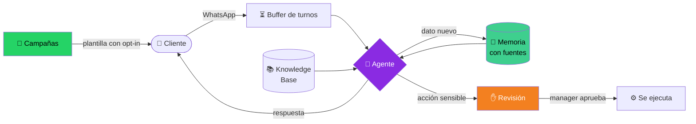

<div align="center">

# 🤝 ARM WhatsApp

### Agent Relationship Management por WhatsApp

**Un agente de IA y tu equipo trabajando juntos la relación con cada cliente.**
No es un bot que contesta: recuerda con fuentes, propone y espera tu aprobación,
y sale a reactivar clientes con consentimiento.


**[🌐 arm-whatsapp.vercel.app](https://arm-whatsapp.vercel.app)**

</div>

---

## 🧠 ¿Qué es un ARM y por qué esto es uno?

Un **CRM** guarda lo que tu equipo carga a mano. Un **ARM** (*Agent Relationship
Management*) pone a un agente de IA a trabajar la relación **junto** al equipo:
conversa, recuerda, propone y actúa, siempre con una persona al mando de lo
importante.

| | Pilar | Cómo lo hace ARM WhatsApp |
| :---: | --- | --- |
| 🧾 | **Memoria con fuentes** | El agente guarda necesidades, objeciones, compromisos y datos citando el mensaje del cliente que los respalda. Lo que no tiene fuente queda como *corazonada*. En la próxima charla arranca sabiendo todo, y el equipo lo ve en «Lo que sabemos». |
| ✋ | **El agente propone, una persona decide** | Las acciones sensibles quedan en **Revisión** hasta que un manager las aprueba. Recién ahí se ejecutan. |
| 📣 | **Reactivación saliente** | **Campañas** a segmentos con opt-in, plantillas aprobadas por Meta, aprobación previa y envío por tandas. Cuando el cliente responde, el agente sigue la charla. |
| 📦 | **Los datos son tuyos** | Configuración → Datos exporta todo en JSON o los contactos en CSV. Las credenciales nunca salen. |



---

## ⚡ La IA: modelos gratis con FreeLLMAPI

El agente corre con **FreeLLMAPI**, un router
local que reparte cada pedido entre proveedores con cupo gratis y salta al
siguiente cuando uno se agota (modelo `auto`). **Costo de IA: cero.**

Corre en tu PC y la app en Vercel lo alcanza por un **túnel de Cloudflare dentro
de Docker**, que arranca solo junto con Docker:


**Conectarlo en 3 pasos**

1. 🐳 Levantá el túnel: [`deploy/freellmapi-tunnel/docker-compose.yml`](deploy/freellmapi-tunnel/docker-compose.yml) → `docker compose up -d`.
2. 🔑 En Vercel cargá las variables:

   | Variable | Valor |
   | --- | --- |
   | `LLM_BASE_URL` | `https://llm.tu-dominio.com/v1` |
   | `LLM_API_KEY` | la clave de FreeLLMAPI |
   | `OPENROUTER_DEFAULT_MODEL` | `auto` |
   | `OPENROUTER_FALLBACK_MODELS` | `auto,auto:fast` |

3. 🚀 Redeploy.

> [!NOTE]
> Sirve cualquier endpoint compatible con la API de OpenAI: cambiás `LLM_BASE_URL`
> y listo. Las variables `OPENROUTER_*` conservan ese nombre por compatibilidad,
> pero apuntan al endpoint que configures. La transcripción de audios y los
> embeddings de la Knowledge Base todavía usan su propia clave de proveedor.

> [!WARNING]
> **Antes de usarlo con clientes reales:** el agente responde solo mientras tu PC
> esté prendida, y los proveedores gratis pueden guardar o entrenar con lo que
> reciben. Ideal para demos y pruebas. Con datos personales de clientes, conviene
> un modelo pago que no entrene con los datos.

### 🧩 Las piezas de IA

| | Pieza | Qué hace |
| :---: | --- | --- |
| 💬 | **Respuesta con herramientas** | Lee memoria, negocio y Knowledge Base y responde. Hasta 5 pasos de herramientas por turno: disponibilidad, agendar en HighLevel, guardar datos del cliente, webhooks. |
| ⏳ | **Buffer de turnos** | Junta los mensajes que el cliente manda seguidos y responde una sola vez, como una persona. |
| 🎙️ | **Notas de voz e imágenes** | Transcribe audios y describe imágenes, así el agente «escucha» y «ve». |
| 📚 | **Knowledge Base (RAG)** | Búsqueda semántica con pgvector sobre los documentos del negocio. |
| 🎯 | **Modo setter** | Califica leads con preguntas eliminatorias y puntaje; los calificados pasan al CRM. |
| 🏷️ | **Etiquetas y resumen** | Etiqueta cada conversación y mantiene un resumen para el contexto largo. |
| ⚖️ | **Juez de mensajes (Jev)** | Opcional: estima intención y probabilidad de baja, y frena lo que no corresponde. |
| 📝 | **Generador de plantillas** | Redacta plantillas listas para la aprobación de Meta. |
| 🧪 | **Playground** | Probás cada agente y su prompt antes de publicarlo. |

### 🛡️ Que la conversación nunca se corte ni se rompa

- 🔁 **Cadena de respaldo:** si un modelo falla o se satura, la misma charla sigue con el siguiente, con los mismos mensajes.
- 🚫 **Guardia de respuestas:** nunca le llega al cliente un texto cortado, vacío o con el razonamiento interno del modelo. Se reintenta o se pasa a otro modelo.
- 🌡️ **Temperatura baja (0.3):** respuestas consistentes de un mensaje al otro.
- 💰 **Control de costos por workspace:** pasado un umbral diario baja a un modelo más barato; pasado el tope, frena y avisa.
- 📏 **Guardrails** por prompt: lo que el agente hace siempre y lo que no hace nunca.

---

## ✅ Auditado contra el curso «Building with the Claude API»

Revisamos ARM WhatsApp **capítulo por capítulo** contra el curso de Anthropic
Academy, probando cada requisito con tráfico real contra FreeLLMAPI (las
funciones exclusivas de Anthropic quedan afuera). Cada falla encontrada se
corrige en el repo.

| Capítulo | Estado | Qué se corrigió |
| --- | :---: | --- |
| 1 · Fundamentos de la API | ✅ | Guardia contra respuestas cortadas o con razonamiento filtrado, temperatura fija, system prompt por el canal correcto. |
| 2 · Evals | 🔄 | Dataset de conversaciones de WhatsApp + calificador por código y por modelo + comparación de prompts (`npm run eval:agente`). |
| 3 · Prompt engineering | ⏳ | — |
| 4 · Tool use | ⏳ | — |
| 5 · RAG | ⏳ | — |
| 6 · Funciones avanzadas | ⏳ | — |

---

## 📦 Qué más incluye

- 📥 **Inbox** tipo WhatsApp Web con buffer inteligente.
- 🔀 **Motor de agente** con state machine, handoff humano, prompts personalizables y herramientas activables.
- 👥 **CRM** con sincronización opcional a HighLevel.
- 🕐 **Templates** y manejo de la ventana de 24 h de Meta.
- 🏢 **Multi-tenant** con roles, RLS por workspace y super admin.

## 🛠️ Stack

| Capa | Tecnología |
| --- | --- |
| ⚛️ Framework | Next.js 16 + React 19 + TypeScript |
| 🎨 Estilos | Tailwind CSS + shadcn/ui |
| 🗄️ Backend | Supabase (Auth + PostgreSQL + RLS + Storage + pgvector) |
| ⚡ IA | FreeLLMAPI (o cualquier endpoint compatible con OpenAI) |
| 💚 WhatsApp | YCloud |
| ▲ Hosting | Vercel |

## 🚀 Instalar

```bash
git clone https://github.com/grancobud/arm-whatsapp.git
cd arm-whatsapp
claude "lee INSTALAR.md e instálalo"
```

El agente configura Supabase, despliega a Vercel, crea el super admin y deja el
cron corriendo. Ver [`INSTALAR.md`](INSTALAR.md).

## 💻 Desarrollo local

```bash
npm install
cp .env.local.example .env.local   # completá tus keys (o: node scripts/setup.mjs env)
npm run dev                        # http://localhost:3000
```

Otros comandos: `npm run build`, `npm run lint`, `npm run typecheck`.

## ⏱️ El cron

Un job de **pg_cron + pg_net** llama cada minuto a `/api/cron/buffer-flush`
(autenticado con `CRON_SECRET`). Drena los mensajes agrupados y envía la
siguiente tanda de las campañas aprobadas. Ver
[`supabase/cron/schedule-buffer-flush.sql`](supabase/cron/schedule-buffer-flush.sql).

## 🗂️ Estructura

```
src/
├── app/        # Next.js App Router ((auth), (main), api/)
├── features/   # Feature-First (arm, inbox, settings, tools, agents, …)
└── shared/     # Reutilizable (components, lib, types)
supabase/
├── migrations/ # Schema (RLS, super admin, pg_cron, ARM, …)
└── cron/       # SQL post-deploy del cron
deploy/
└── freellmapi-tunnel/  # Túnel de Cloudflare en Docker
scripts/
├── setup.mjs       # Orquestador de instalación (secrets, env, db, cron)
└── seed-admin.mjs  # Super admin + workspace demo
```

## 🔐 Variables de entorno y seguridad

Ver [`.env.local.example`](.env.local.example). `ENCRYPTION_KEY`,
`BUFFER_PROCESS_SECRET` y `CRON_SECRET` las genera `scripts/setup.mjs`. YCloud y
HighLevel se configuran por workspace en Settings → Integraciones.

Lo que se guarda en Integraciones se cifra con **AES-256-GCM** antes de tocar la
base, ligado a su `workspace_id` y proveedor: un blob copiado de un tenant a otro
no descifra.

---

## 👥 Autores

ARM WhatsApp es un trabajo conjunto de:

| | |
| :---: | --- |
|  | **Gastón R. Persoglia** · [@grancobud](https://github.com/grancobud) |
|  | **Tomas Skarp** · [@thomasskarp](https://github.com/thomasskarp) |

## 📄 Licencia

[MIT](LICENSE).
