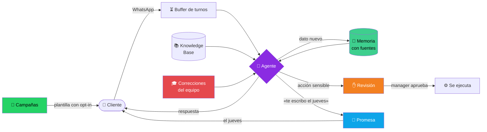
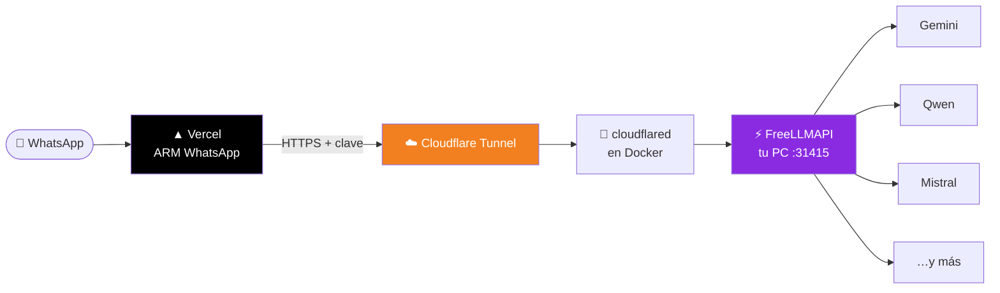
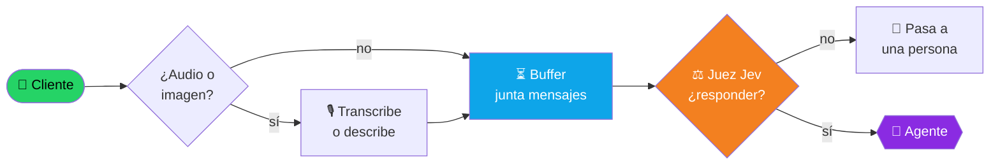
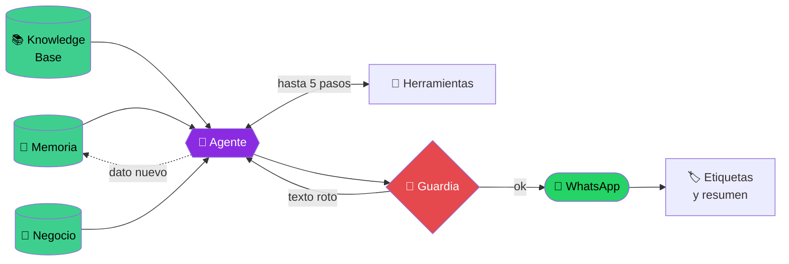
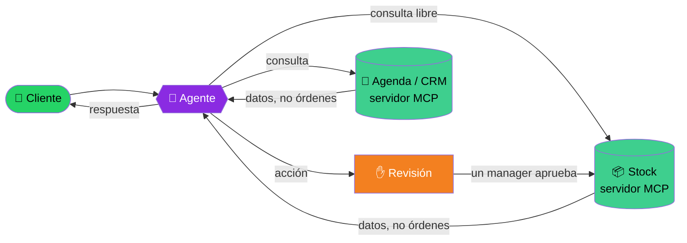
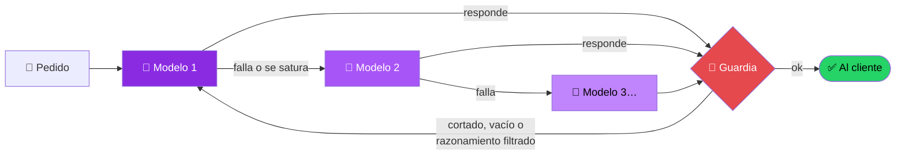

<div align="center">

# 🤝 ARM WhatsApp

### Agent Relationship Management por WhatsApp

**Un agente de IA y tu equipo trabajando juntos la relación con cada cliente.**
No es un bot que contesta: recuerda con fuentes, propone y espera tu aprobación,
y sale a reactivar clientes con consentimiento.


**[🌐 arm-whatsapp.vercel.app](https://arm-whatsapp.vercel.app)**

</div>

---

## 🧠 ¿Qué es un ARM y por qué esto es uno?

Un **CRM** guarda lo que tu equipo carga a mano. Un **ARM** (*Agent Relationship
Management*) pone a un agente de IA a trabajar la relación **junto** al equipo:
conversa, recuerda, propone y actúa, siempre con una persona al mando de lo
importante.

| | Pilar | Cómo lo hace ARM WhatsApp |
| :---: | --- | --- |
| 🧾 | **Memoria con fuentes** | El agente guarda necesidades, objeciones, compromisos y datos citando el mensaje del cliente que los respalda. Lo que no tiene fuente queda como *corazonada*. En la próxima charla arranca sabiendo todo, y el equipo lo ve en «Lo que sabemos». |
| ✋ | **El agente propone, una persona decide** | Las acciones sensibles quedan en **Revisión** hasta que un manager las aprueba. Recién ahí se ejecutan. |
| 📣 | **Reactivación saliente** | **Campañas** a contactos que aceptaron promociones (escribirle al negocio no alcanza: una persona lo registra con su fuente), plantillas aprobadas por Meta, aprobación previa y envío por tandas. Cuando el cliente responde, el agente sigue la charla. |
| 🤝 | **Cumple lo que promete** | Si el agente le dice a un cliente «te escribo el jueves», lo agenda y el jueves le escribe. Pasadas las 24 h de WhatsApp usa la plantilla aprobada que elijas en Automatizaciones; si no hay, le llega un mail al equipo para que escriba una persona. Las promesas se ven en la ficha del contacto. |
| 🎚️ | **Autonomía que se gana** | Cada herramienta tiene su modo: «Lo hace solo» o «Lo propone y alguien aprueba». Con 10 aprobaciones seguidas sin un rechazo, la pantalla sugiere darle más autonomía en esa tarea. |
| 🎓 | **Aprende de las correcciones** | «Corregir» en una respuesta de la IA, o rechazar una propuesta en Revisión explicando por qué, deja una lección. El agente sigue las 15 más nuevas en cada charla, y el equipo las ve en «Lo que aprendió el agente». |
| 🌡️ | **Sabe con quién hablar hoy** | Cada contacto tiene un puntaje de relación de 0 a 100 (cuándo escribió, cuánto escribe, si responde, su etapa y los riesgos abiertos) y un estado: activa, enfriándose, fría o perdida. El Panel sugiere «Para escribirle hoy». |
| 🚫 | **Respeta la baja** | Si el cliente escribe «BAJA», se la confirma y nadie le vuelve a escribir: ni la IA, ni las campañas, ni las automatizaciones. Con «ALTA» vuelve. |
| 📊 | **Mide resultados, no mensajes** | El Panel cuenta turnos agendados, leads calificados, el porcentaje que resolvió la IA sola, promesas cumplidas, bajas y respuestas a campañas, también por agente. |
| 📦 | **Los datos son tuyos** | Configuración → Datos exporta todo en JSON o los contactos en CSV. Las credenciales nunca salen. |



---

## ⚡ La IA: modelos gratis con FreeLLMAPI

El agente corre con **FreeLLMAPI**, un router
local que reparte cada pedido entre proveedores con cupo gratis y salta al
siguiente cuando uno se agota (modelo `auto`). **Costo de IA: cero.**
Producción usa `dots-3-note` como modelo principal y `auto` de respaldo, porque fue el que mejor usó las herramientas en las pruebas.

Corre en tu PC y la app en Vercel lo alcanza por un **túnel de Cloudflare dentro
de Docker**, que arranca solo junto con Docker:



**Conectarlo en 3 pasos**

1. 🐳 Levantá el túnel: [`deploy/freellmapi-tunnel/docker-compose.yml`](deploy/freellmapi-tunnel/docker-compose.yml) → `docker compose up -d`.
2. 🔑 En Vercel cargá las variables:

   | Variable | Valor |
   | --- | --- |
   | `LLM_BASE_URL` | `https://llm.tu-dominio.com/v1` |
   | `LLM_API_KEY` | la clave de FreeLLMAPI |
   | `OPENROUTER_DEFAULT_MODEL` | `dots-studio/dots-3-note-preview:free` (es una versión preview: si tu FreeLLMAPI no lo ofrece, usá `auto`) |
   | `OPENROUTER_FALLBACK_MODELS` | `auto,auto:fast` |

3. 🚀 Redeploy.

> [!IMPORTANT]
> **Respaldo:** si `LLM_BASE_URL` no responde (la PC apagada, el túnel caído o
> FreeLLMAPI sin cupo), la misma consulta va a OpenRouter con
> `OPENROUTER_API_KEY` y un modelo gratis (`google/gemma-4-31b-it:free` y
> después `openrouter/free`; `LLM_BACKUP_MODELS` los cambia). Durante un minuto
> se usa directo el respaldo y llega un mail de alerta. Sin `OPENROUTER_API_KEY`
> no hay respaldo.

> [!NOTE]
> Sirve cualquier endpoint compatible con la API de OpenAI: cambiás `LLM_BASE_URL`
> y listo. Las variables `OPENROUTER_*` conservan ese nombre por compatibilidad,
> pero apuntan al endpoint que configures. Los embeddings de la Knowledge Base
> también salen de ahí (`gemini-embedding-001`, fijo; `KB_EMBEDDING_MODEL` lo
> cambia, pero hay que volver a cargar los documentos). Las imágenes también (`MEDIA_IMAGE_MODEL`,
> por defecto `mistral-medium-3.5`) y las notas de voz (`MEDIA_AUDIO_MODEL`, por
> defecto `whisper-large-v3`, por `/audio/transcriptions`).

> [!WARNING]
> **Antes de usarlo con clientes reales:** el agente responde solo mientras tu PC
> esté prendida, y los proveedores gratis pueden guardar o entrenar con lo que
> reciben. Ideal para demos y pruebas. Con datos personales de clientes, conviene
> un modelo pago que no entrene con los datos.
>
> La página `/privacidad` es un borrador: completá `NEXT_PUBLIC_LEGAL_NAME`, `NEXT_PUBLIC_LEGAL_ADDRESS` y `NEXT_PUBLIC_LEGAL_EMAIL`, hacela revisar por un abogado y recién entonces poné `NEXT_PUBLIC_LEGAL_REVIEWED=true`.

### 🧩 Las piezas de IA

Así recorre un mensaje del cliente todas las piezas.

**1 · Llega el mensaje**



**2 · El agente responde**



| | Pieza | Qué hace |
| :---: | --- | --- |
| 💬 | **Respuesta con herramientas** | Lee memoria, negocio y Knowledge Base y responde. Hasta 5 pasos de herramientas por turno: disponibilidad, agendar en HighLevel, guardar datos del cliente, webhooks. |
| ⏳ | **Buffer de turnos** | Junta los mensajes que el cliente manda seguidos y responde una sola vez, como una persona. |
| 🎙️ | **Notas de voz e imágenes** | Transcribe audios y describe imágenes, así el agente «escucha» y «ve». |
| 📚 | **Knowledge Base (RAG)** | Búsqueda semántica con pgvector sobre los documentos del negocio. |
| 🎯 | **Modo setter** | Califica leads con preguntas eliminatorias y puntaje; los calificados pasan al CRM. |
| 🏷️ | **Etiquetas y resumen** | Etiqueta cada conversación y mantiene un resumen para el contexto largo. |
| ⚖️ | **Juez de mensajes (Jev)** | Opcional: estima intención y probabilidad de baja, y frena lo que no corresponde. Gratis con FreeLLMAPI (12/12 en `npm run eval:jev`) o con TypeSafe si hay `TYPESAFE_API_KEY`. |
| 📝 | **Generador de plantillas** | Redacta plantillas listas para la aprobación de Meta. |
| 🧪 | **Playground** | Probás cada agente y su prompt antes de publicarlo. |

### 🔌 Los sistemas del negocio, por MCP

En **Configuración → Sistemas (MCP)** cada negocio conecta el servidor MCP de su
stock, su agenda o su CRM. El agente usa esas herramientas en la charla sin que
haya que programar la integración, y un manager decide cuáles quedan libres y
cuáles piden aprobación.



- 🔐 La clave de cada sistema se guarda cifrada y nunca llega al navegador.
- ✋ Toda acción de un sistema externo pide aprobación, salvo las que un manager marque como libres.
- 🧾 Lo que devuelve un sistema es dato: una orden escondida en la respuesta no se cumple.
- 📴 Si un sistema no responde, el agente avisa que ahora no lo puede consultar en vez de inventar.

### 🛡️ Que la conversación nunca se corte ni se rompa



- 🔁 **Cadena de respaldo:** si un modelo falla o se satura, la misma charla sigue con el siguiente, con los mismos mensajes.
- 🚫 **Guardia de respuestas:** nunca le llega al cliente un texto cortado, vacío o con el razonamiento interno del modelo. Se reintenta o se pasa a otro modelo.
- 🌡️ **Temperatura baja (0.3):** respuestas consistentes de un mensaje al otro.
- 💰 **Control de costos por workspace:** pasado un umbral diario baja a un modelo más barato; pasado el tope, frena y avisa.
- 📏 **Guardrails** por prompt: lo que el agente hace siempre y lo que no hace nunca.

---

## ✅ Auditado y mejorado

ARM WhatsApp se audita área por área con pruebas reales contra los modelos de
FreeLLMAPI. Cada falla que aparece se corrige en el repo. Las funciones del ARM
(de Automatizaciones para abajo) se construyeron con sus pruebas: `npm run test:unit`
corre 291.

| Área | Estado | Qué se mejoró |
| --- | :---: | --- |
| 💬 Respuestas de la IA | ✅ | Guardia contra respuestas cortadas o con razonamiento filtrado, temperatura fija y system prompt por el canal correcto. |
| 📊 Evaluación del agente | ✅ | Set de 14 conversaciones de WhatsApp con calificación automática por código y por modelo (`npm run eval:agente`). Encontró y se corrigió que una anotación en la memoria del cliente podía hacer que el agente ofreciera descuentos inexistentes. |
| ✍️ Prompts | ✅ | Prompts de arranque nuevos para los 4 tipos de agente: reglas claras con su porqué, etiquetas XML y ejemplos para los casos difíciles. En la evaluación pasó de 9.1 a 9.6: respeta la baja, usa la memoria del cliente y no revela sus instrucciones. |
| 🔧 Herramientas | ✅ | Prueba con la función real y herramientas simuladas (`npm run eval:herramientas`): de 14/20 a 40/42 chequeos. Ahora consulta la agenda antes de ofrecer turnos, no tapa un error del calendario, guarda la memoria del cliente desde la primera charla, siempre responde con texto después de usar una herramienta, no reintenta acciones que podrían reservar dos veces y cuenta bien los tokens de los turnos con herramientas. |
| 📚 Base de conocimiento | ✅ | Embeddings gratis por FreeLLMAPI con un modelo fijo, corte de documentos por secciones (sin partir palabras ni precios) y fragmentos marcados como datos para que una página importada no pueda dar órdenes. Medido con `npm run eval:conocimiento`: el fragmento correcto queda primero en 15 de 17 preguntas (antes 11). Se quitó una búsqueda de respaldo que armaba SQL pegando texto. |
| 🎙️ Audios, imágenes, documentos y caché | ✅ | Notas de voz transcriptas por FreeLLMAPI, sin clave aparte: el chat del router descartaba el audio, así que van por el endpoint de transcripción con un modelo fijo y salen palabra por palabra, números incluidos. Imágenes por FreeLLMAPI con modelo fijo, que copian exactos importes y números de operación de un comprobante. PDFs leídos del lado del servidor: antes el agente decía «no puedo leer su contenido», ahora responde el total y la seña exactos. Imágenes y documentos entran marcados como datos (un cartel con una orden no la hace cumplir). El prompt pone primero lo fijo de cada cliente: el comienzo reutilizable entre mensajes pasó del 1% al 72% y un proveedor con caché ya lee el 83% desde caché (`npm run eval:multimedia`, `npm run eval:cache`). |
| 📌 Citas y razonamiento | ✅ | Cada respuesta que usa la base de conocimiento deja rastro del fragmento que la respalda: el agente lo marca, la marca se saca antes de llegar al cliente y el inbox muestra «Fuentes» con el texto citado. En la evaluación citó bien 8 de 8 (incluido no citar cuando el fragmento no servía). El razonamiento extendido no se activa: el agente ya saca 9.6 y la guardia descarta el razonamiento que algunos modelos mezclan en la respuesta. |
| 🔌 MCP | ✅ | **Servidor:** el MCP de administración pasó al repo (`mcp/admin/`) con herramientas descriptas parámetro por parámetro, errores que el cliente reconoce, 4 recursos, 3 prompts probados y las funciones del ARM: 28/28 con un cliente MCP real. **Cliente:** cada negocio conecta el servidor MCP de su stock, agenda o CRM y el agente lo usa, con aprobación humana por defecto, resultados marcados como datos y aviso honesto si el sistema no responde: 28/28 en `npm run eval:mcp`. Encontró que el agente decía «no tenemos» sin consultar sus herramientas: corregido sin bajar la evaluación (agente 9.6, herramientas 40/42). |
| 🎯 RAG: Reranking y recuperación contextual | ✅ | **Recuperación contextual:** cada fragmento incorpora su jerarquía de documento y sección (`[Documento · Sección]`) para no perder contexto situacional al aislarse. **Reranking híbrido:** ampliación de candidatos iniciales a 10 y reordenamiento con BM25 y Reciprocal Rank Fusion (RRF) en memoria: prioriza términos específicos y códigos exactos (como `PROMO-DIC-05` o `ESTUDIANTE-15`) con cero costo de tokens y latencia imperceptible. En `npm run eval:conocimiento`: pasó de 15/17 a **17 de 17 aciertos (100%)** en el top 3, manteniendo el rechazo de consultas fuera de dominio. 6 tests unitarios nuevos. Por [Tomas Skarp](https://github.com/thomasskarp). |
| 🧭 Agentes y flujos de trabajo | ✅ | **Enrutamiento:** validación de máquina de estados (`ai_active`, `human_active`, `handoff_pending`, etc.) y detección normalizada de pedidos de operador humano sin falsos positivos en consultas de negocio (6 tests unitarios). **Encadenamiento protegido:** se eliminó el riesgo de terminación prematura en entornos serverless/Vercel esperando el auto-etiquetado y resumen (`maybeAutoProcess`) con captura de errores aislada; blindaje de la etapa `customer` contra degradaciones a `lost` y freno de costos en calificación (4 tests unitarios). **Paralelización:** carga concurrente de memoria, agente activo, datos de negocio y base de conocimiento en un único `Promise.all`, ahorrando 25–35 ms de latencia por turno. **Observabilidad:** registro estructurado del evento `dispatch_failure` en la tabla `events` ante fallos de entrega en WhatsApp. Por [Tomas Skarp](https://github.com/thomasskarp). |
| ⚙️ Automatizaciones | ✅ | Reglas «cuando pase X, hacé Y» que el cron revisa cada minuto. Cada disparo se reserva una sola vez en `automation_runs` (aunque el cron corra dos veces no se repite), solo reacciona a lo que pasó después de guardar la regla y los seguimientos salen de 9 a 21 en la hora del negocio. 9 tests en `evals/automatizaciones`. |
| 🚫 Consentimiento | ✅ | «BAJA» y «ALTA» se reconocen antes de que conteste la IA, con palabras exactas o frases claras en mensajes cortos, para no dar de baja a quien solo menciona la palabra. A un contacto dado de baja no le contesta nadie, y un mensaje nuevo ya no lo vuelve a dar de alta solo. 5 tests en `evals/consentimiento`. |
| 🤝 Promesas | ✅ | La herramienta «Cumplir lo prometido» agenda el seguimiento con la zona horaria obligatoria (una hora sin zona saldría corrida). Al vencer decide si escribir texto (ventana abierta), mandar la plantilla elegida, dejárselo a una persona (la charla la lleva un humano o pasaron 24 h sin plantilla) o cancelarlo (conversación cerrada o el cliente pidió la baja). 8 tests en `evals/compromisos`. |
| 🎚️ Autonomía graduada | ✅ | Cada herramienta pasa de «propone» a «lo hace solo» según el historial de aprobaciones; un rechazo reinicia la cuenta y cada cambio queda registrado. 4 tests en `evals/autonomia`. |
| 🎓 Aprender de las correcciones | ✅ | Las correcciones y los rechazos explicados entran al prompt como lecciones cortas, marcadas como reglas del equipo (no como mensajes del cliente) y con tope de 15. 4 tests en `evals/correcciones`. |
| 🌡️ Puntaje de la relación | ✅ | Puntaje de 0 a 100 y estado por contacto, calculado con funciones puras y probado con casos de borde (contacto nuevo, dado de baja, con riesgos abiertos). 6 tests en `evals/relacion`. |
| 📊 Resultados y métricas por agente | ✅ | El Panel mide resultados en vez de volumen, y cada resultado se cuenta para el agente que estaba activo en ese momento (cada activación queda registrada). 6 tests en `evals/metricas`. |
| ⚖️ Jev gratis | ✅ | El juez de mensajes corre gratis por FreeLLMAPI cuando no hay clave de TypeSafe: lee el último JSON de la respuesta, acota los valores y no cuesta nada. En `npm run eval:jev`: 12 de 12, incluido un intento de manipular al agente. 5 tests más en `evals/jev`. |
| 🔁 Respaldo de la IA | ✅ | Si FreeLLMAPI no responde (PC apagada, túnel caído, sin cupo o más de 45 s), la misma charla sigue por OpenRouter con un modelo gratis, salta al siguiente si ese no está, deja de probar el principal por un minuto y avisa por mail. 8 tests en `evals/respaldo`. |
| 👀 Inspección del entorno | ✅ | Después de cada acción el agente mira qué pasó de verdad. Al reservar, la herramienta le devuelve la hora que **guardó el calendario** (antes devolvía la que pidió el agente: si HighLevel la corría, el cliente recibía una hora equivocada) y un error si el turno quedó cancelado aunque la API diga 200. `npm run eval:herramientas` suma 4 escenarios donde la acción sale mal (la reserva falla, se corre de hora, el horario se ocupa entre la consulta y la reserva, el seguimiento no se guarda): 22 de 22 chequeos, sin confirmar nada que no pasó y ofreciendo el horario libre. 4 tests en `evals/herramientas`. |
| 🧐 Revisor de respuestas (evaluador-optimizador) | ✅ | Antes de mandar cada respuesta, un segundo modelo la compara con todo lo que sabía el agente (negocio, base de conocimiento, memoria del cliente y lo que devolvieron las herramientas en ese turno). Si encuentra un dato inventado o una acción que no se hizo ("te agendé" sin reserva, una reserva que falló o quedó pendiente), la reescribe sin volver a usar herramientas y revisa la corrección, con tope de 2 vueltas y 25 s en total. Si la acción no se hizo, ofrece pasar con una persona en vez de prometer que el equipo confirma. Si el revisor falla, sale el borrador: nunca deja al cliente sin respuesta. En `npm run eval:revisor` (24 borradores fijos: trampas y respuestas correctas, 8 de ellos distintos a los ejemplos del prompt), con llama-3.3-70b: **12 de 13 trampas corregidas y 11 de 11 respuestas correctas sin tocar**. Con "auto" los modelos que razonan se cortaban o tardaban de más, y mistral-small corregía todas las trampas pero tocaba respuestas correctas. El chat de prueba muestra qué se corrigió. 11 tests en `evals/revisor`. |
| 🛡️ Guardias sobre el modelo | ✅ | Lo que el prompt pide y el modelo gratis a veces no cumple se asegura en el código, sin otra llamada al modelo: una queja clara o un pedido de hablar con una persona llega a una persona, el nombre y el correo que el cliente afirma como propios quedan en la ficha, un nombre no se deduce del correo y, sin herramienta de agenda, la oferta de un turno se cambia por el pase a una persona. Si promete escribirle más adelante sin agendarlo, lo toma una persona. 20 tests en `evals/herramientas/guardias.test.ts`. |
| 🔐 Prueba de intrusión | ✅ | Ataques propios contra una copia local con datos inventados. Encontró tres fallas graves, cada una reproducida antes de corregirla: un usuario podía hacerse súper admin, llevarse un contacto de otro cliente o cambiarle el prompt a su agente. Los mismos ataques ahora quedan bloqueados (`evals/intrusion`). Además, los scripts de cada página corren con un nonce por pedido y sin `unsafe-inline`. |
| 🗄️ Base de datos | ✅ | Se cerraron los avisos de Supabase: 100 de políticas redundantes, 3 de funciones de permisos visibles por la API y 3 de extensiones en `public`, además de los índices que faltaban. Antes de aplicarlo se comparó una matriz de 690 combinaciones de rol, tabla y acción: 0 diferencias. |
| 🧾 Datos personales | ✅ | Revisado contra la Ley 25.326: botón para borrar todos los datos de una persona, descarga de sus datos, plazo de conservación por cliente (12 meses por defecto), aviso en el primer mensaje y página `/privacidad`. La memoria del agente rechaza datos de salud, religión, política y vida sexual. No reemplaza la revisión de un abogado. |
| 🔄 Turnos sin repetir acciones | ✅ | Revisado contra 12-Factor Agents. El progreso se guarda antes de cada paso, así que un corte no vuelve a reservar ni a reenviar: si no se sabe si el mensaje salió, pasa a una persona. Un mensaje nuevo ya no abre un turno en paralelo, y aprobar o rechazar en Revisión le avisa al cliente. |
| 🤝 Pase a una persona y ficha | ✅ | El agente prometía «le paso tu mensaje» sin que nadie se enterara: ahora el pase es real y, si lo promete, el código lo cumple. Guarda nombre y correo citando al cliente; pisar un dato distinto va a Revisión, y cada cambio se puede deshacer desde la ficha. Tampoco discute con un cliente enojado. |
| ⏱️ Tiempos y filtro de respuestas | ✅ | Una respuesta llegó a tardar 209 s con un webhook de 60: ahora cada llamada al modelo tiene un tope de 25 s y se reservan 8 s para enviar. El filtro también frena el razonamiento en castellano y palabras en inglés como «turnover», que el modelo metía en las respuestas. |
| 📱 Uso y celular | ✅ | En celular la Bandeja se rompía: ahora muestra la lista o la conversación, con botón para volver. El Panel y la Bandeja vacía dicen cuál es el siguiente paso, cada agente tiene su botón Probar y hay menos jerga. |
| 🧪 Examen de producción | ✅ | Un 9.7 en `eval:agente` no detectaba estas fallas porque usa otro modelo y no tiene herramientas. `npm run eval:produccion` recorre los mismos pasos que un mensaje real, con el modelo que responde de verdad y las herramientas simuladas. Última medición, del 05/11: con `dots-3-note`, 447 de 453 chequeos y la agenda consultada siempre; con `qwen3.8-27b`, que es donde puede caer `auto`, 435 de 459 y a veces ni consulta. Con turnos cortados y hasta 13 de 51 respuestas sin revisar, no cuenta como línea base. Por esta comparación, producción pasó a `dots-3-note`, con `auto` de respaldo. Leer las respuestas encontró fallas que la nota no mostraba. También se corrigió que las repeticiones de `eval:agente` eran la misma respuesta cacheada. |
| 📲 Recorrido de WhatsApp simulado | ✅ | Un webhook firmado como los de YCloud entra por la ruta real y se sigue hasta el envío, con YCloud y el modelo falsos (`npm run eval:recorrido`). Encontró que una falla en la búsqueda de la base de conocimiento cortaba el turno entero, que sin cupo o con YCloud caído el cliente quedaba sin respuesta y sin que nadie lo viera en la Bandeja, y que un webhook sin `wsid` perdía los mensajes de los clientes más allá del décimo. Prueba también firmas, duplicados, ráfagas y bajas. Sin número real: no reemplaza probar contra Meta. |
| 💭 Conversaciones largas | ✅ | `npm run eval:charlas`: 12 charlas de hasta 9 mensajes, turno por turno y con la misma ventana de historial que producción. Encontró que, pasados 10 mensajes, el agente negaba que le hubieran dicho el nombre aunque estuviera en la ficha, que cambiar el día de un seguimiento dejaba vivo el anterior y el cliente recibía dos mensajes, y que ofrecer una persona en cada precio terminaba en traspasos que nadie pidió. No cedió ante un falso dueño ni ante la insistencia. |
| ⚖️ Sesgos de la IA | ✅ | `npm run eval:sesgos`: los mismos pedidos con errores de ortografía, formales, en mayúsculas, como audio mal transcripto y de personas con distintos nombres, orígenes y situaciones. Última corrida: 64 de 64 sin falla. En otra anterior, contar un dato de salud llegó a dejar a alguien sin el precio, y se corrigió la regla del agente. Encontró que el filtro de la memoria dejaba pasar religiones, discapacidades, identidad de género y política, y que una queja escrita con mucha educación podía quedarse sin traspaso. Es una muestra chica: encuentra diferencias, no prueba que no haya. |
| 🚧 Examen de conducta | ✅ | Hasta acá un cambio podía empeorar al agente y publicarse igual. `npm run eval:conducta` corre en tu PC unas charlas elegidas, con el modelo de producción y sin respaldo, y si aprueba escribe `evals/conducta/constancia.json`, sin texto de ninguna charla. GitHub compara esa constancia con el código sin llamar a ningún modelo: si tocaste algo de lo que dependen las respuestas, el PR queda en rojo hasta correrlo otra vez; si no, pasa sin gastar cupo. Inventar datos, contar lo interno, no derivar, guardar datos sensibles e ignorar una baja bloquean; un error del modelo no cuenta como mala conducta. Para probar un prompt antes de publicarlo: `EVAL_PROMPT_ARCHIVO=ruta npm run eval:conducta`. Sin cupo y con un arreglo urgente: `npm run eval:conducta:excepcion -- "motivo"`, que queda escrito y no se encadena. La constancia evita olvidos, no engaños. Todavía no pasan por acá publicar un prompt desde la app ni los cambios en `buffer.ts` o `lessons.ts`, que el examen no importa, y un examen que aprueba no prueba que cada guardia funcione: una guardia desactivada no lo hizo fallar, por eso también tienen tests propios. |
| 🔭 Observabilidad | ✅ | Encontró que un error del modelo volcaba el prompt y los mensajes del cliente en los logs: ahora solo se escribe el nombre y el mensaje del error. Suma un vigilante externo con GitHub Actions y `/api/health`, porque las alertas corren dentro del cron que vigilan; aviso de errores que ninguna ruta atrapó; un evento por turno con tiempos, revisor y guardias, sin contenido; alerta si el revisor falla seguido, y un panel de operación para el súper admin. Todo gratis y sin proveedores nuevos. |
| ⚡ Rendimiento | ✅ | Las funciones corrían en Estados Unidos con la base en Brasil, y cada consulta cruzaba el continente: ahora corren en São Paulo. Un cliente con el modelo colgado ya no demora a otro, porque cada webhook atiende su propia conversación, y el cron tiene un tope para que los seguimientos y las alertas no se queden sin correr. El historial del cron se limpia solo. `npm run eval:volumen` midió en local: con 205.000 mensajes, la mediana de las pantallas queda por debajo de 0,4 s. Una ráfaga de 300 mensajes de 100 clientes encontró que una charla ocupada frenaba toda la cola y que un lote podía quedar colgado 5 minutos: corregido, se vacía sin perder mensajes. Los mensajes simultáneos de un mismo cliente ahora entran en un solo lote, aunque eso todavía no se volvió a medir con la ráfaga. Sigue abierto: el revisor agrega de 12 a 25 s por respuesta, el cron atiende 10 lotes por minuto y falta medir la capacidad en producción. |
| 🏗️ Código y arquitectura | ✅ | Sin ciclos entre módulos. Encontró que ningún PR corría las pruebas: ahora las corre GitHub Actions. Los guardias estaban copiados en cuatro lugares, y por eso un examen dejó de medirlos: ahora están en uno solo. Una herramienta de desarrollo de 393 KB ya no llega a los usuarios. Se unificaron 50 copias de la conexión a la base y se quitaron dependencias y archivos sin usar. `processClaimedBatch` sigue teniendo unas 570 líneas. |
| 📦 Dependencias | ✅ | `npm audit` pasó de 8 avisos moderados a 0, sin bajar de versión `eslint-config-next`. |

Todas siguieron el mismo camino: se **prueba de verdad**, se encuentra la **falla**, se **corrige** y se **vuelve a medir**.

---

## 📦 Qué más incluye

- 📥 **Inbox** tipo WhatsApp Web con buffer inteligente.
- 📖 **Manual de uso** dentro de la app (`/ayuda`): primeros pasos que se marcan solos según lo que ya está configurado, el día a día, cada pantalla y preguntas comunes.
- 🔁 **Turnos que no repiten acciones**: si un turno se corta después de usar una herramienta, pasa a una persona en vez de reservar dos veces; una respuesta ya enviada no se reenvía, y cada conversación corre de a un turno por vez.
- 📏 **Reglas de WhatsApp**: campañas con tope de 250 personas por día (`CAMPAIGN_DAILY_LIMIT` para cambiarlo), freno solo si fallan muchos envíos o Meta pausa la plantilla, y plantillas que dicen cómo darse de baja. El agente no pide tarjetas, cuentas ni documentos.
- 🔀 **Motor de agente** con state machine, handoff humano, prompts personalizables y herramientas activables.
- 👥 **CRM** con sincronización opcional a HighLevel.
- 🕐 **Templates** y manejo de la ventana de 24 h de Meta.
- 🏢 **Multi-tenant** con roles, RLS por workspace y super admin.
- 🔌 **Cliente MCP**: los sistemas del negocio (stock, agenda, CRM) conectados por MCP, con permisos por herramienta.
- 🔌 **Servidor MCP de administración** ([`mcp/admin/`](mcp/admin/README.md)): operás la instalación desde Claude con 24 herramientas, 4 recursos y 3 prompts.

## 🛠️ Stack

| Capa | Tecnología |
| --- | --- |
| ⚛️ Framework | Next.js 16 + React 19 + TypeScript |
| 🎨 Estilos | Tailwind CSS + shadcn/ui |
| 🗄️ Backend | Supabase (Auth + PostgreSQL + RLS + Storage + pgvector) |
| ⚡ IA | FreeLLMAPI (o cualquier endpoint compatible con OpenAI) |
| 💚 WhatsApp | YCloud |
| ▲ Hosting | Vercel |

## 🚀 Instalar

```bash
git clone https://github.com/grancobud/arm-whatsapp.git
cd arm-whatsapp
claude "lee INSTALAR.md e instálalo"
```

El agente configura Supabase, despliega a Vercel, crea el super admin y deja el
cron corriendo. Ver [`INSTALAR.md`](INSTALAR.md).

## 💻 Desarrollo local

```bash
npm install
cp .env.local.example .env.local   # completá tus keys (o: node scripts/setup.mjs env)
npm run dev                        # http://localhost:3000
```

Otros comandos: `npm run build`, `npm run lint`, `npm run typecheck`.

## ⏱️ El cron

Un job de **pg_cron + pg_net** llama cada minuto a `/api/cron/buffer-flush`
(autenticado con `CRON_SECRET`). Drena los mensajes agrupados y envía la
siguiente tanda de las campañas aprobadas. Ver
[`supabase/cron/schedule-buffer-flush.sql`](supabase/cron/schedule-buffer-flush.sql).

## 🚨 Alertas por mail

Cada 5 minutos el cron revisa si hubo problemas nuevos y, si los hay, manda
**un solo mail** con el resumen por cliente: mensajes que quedaron sin
responder, herramientas que fallaron, sistemas MCP caídos o el umbral diario de
costo. Después espera 30 minutos antes del próximo aviso. Lo normal del negocio
(un lead descartado, una acción esperando aprobación) no avisa, y el mail nunca
lleva mensajes de clientes.

| Variable | Valor |
| --- | --- |
| `RESEND_API_KEY` | clave de [Resend](https://resend.com) (el plan gratis alcanza) |
| `ALERT_EMAIL_TO` | a quién avisar (varios, separados por coma) |
| `ALERT_EMAIL_FROM` | opcional; sin dominio propio en Resend, dejala vacía y solo se puede avisar al mail de la cuenta de Resend |

Sin `RESEND_API_KEY` o `ALERT_EMAIL_TO`, las alertas quedan apagadas.

## ⚙️ Automatizaciones

En **Configuración → Automatizaciones** cada cliente arma reglas del tipo
«cuando pase X, hacé Y». El cron las revisa cada minuto:

| Cuando… | Se dispara |
| --- | --- |
| Primer mensaje | una vez por conversación nueva en la que el contacto escribió |
| Palabra clave | una vez por mensaje que la contenga (sin importar tildes ni mayúsculas) |
| Pide una persona | cada vez que la conversación pasa a esperar un asesor |
| Lead calificado | una vez por contacto |
| Sin respuesta | si hablamos último y el contacto no contesta en 24 h (configurable): un solo seguimiento por silencio, y solo de 9 a 21 en la hora del negocio |
| Ventana por cerrar | cuando le quedan 2 h a la ventana de 24 h de WhatsApp |

Las acciones son mandar una plantilla aprobada (respeta a quien pidió no recibir
mensajes), poner una etiqueta, cerrar la conversación o pasarla a una persona.
Una regla solo reacciona a lo que pasó **después** de guardarla, cada disparo
queda en `automation_runs` y nunca se repite, y un pase a persona hecho por una
automatización no dispara otra.

## 🗂️ Estructura

```
src/
├── app/        # Next.js App Router ((auth), (main), api/)
├── features/   # Feature-First (arm, inbox, settings, tools, agents, …)
└── shared/     # Reutilizable (components, lib, types)
supabase/
├── migrations/ # Schema (RLS, super admin, pg_cron, ARM, …)
└── cron/       # SQL post-deploy del cron
deploy/
└── freellmapi-tunnel/  # Túnel de Cloudflare en Docker
mcp/
└── admin/          # Servidor MCP de administración (herramientas, recursos, prompts)
scripts/
├── setup.mjs       # Orquestador de instalación (secrets, env, db, cron)
└── seed-admin.mjs  # Super admin + workspace demo
```

## 🔐 Variables de entorno y seguridad

Ver [`.env.local.example`](.env.local.example). `ENCRYPTION_KEY`,
`BUFFER_PROCESS_SECRET` y `CRON_SECRET` las genera `scripts/setup.mjs`. YCloud y
HighLevel se configuran por workspace en Settings → Integraciones.

Lo que se guarda en Integraciones se cifra con **AES-256-GCM** antes de tocar la
base, ligado a su `workspace_id` y proveedor: un blob copiado de un tenant a otro
no descifra.

---

## 👥 Autores

ARM WhatsApp es un trabajo conjunto de:

| | |
| :---: | --- |
|  | **Gastón R. Persoglia** · [@grancobud](https://github.com/grancobud) |
|  | **Tomas Skarp** · [@thomasskarp](https://github.com/thomasskarp) |

## 📄 Licencia

[MIT](LICENSE).
